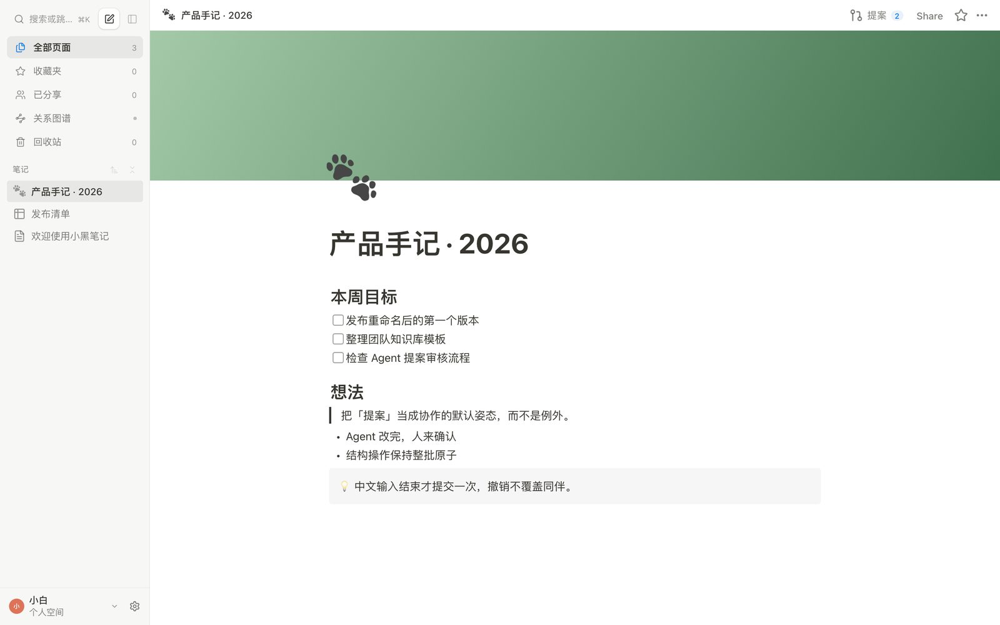
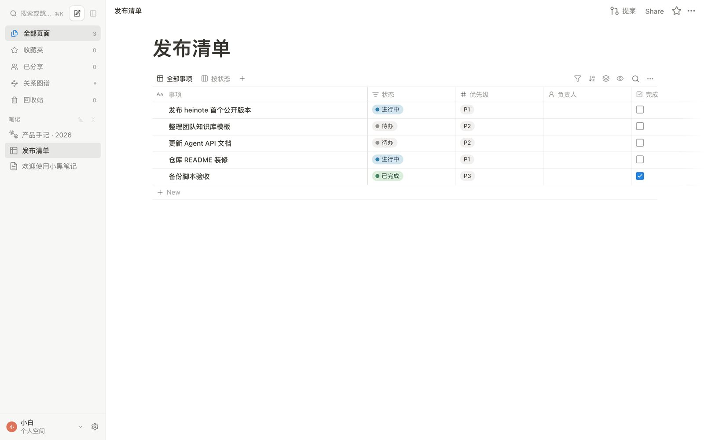
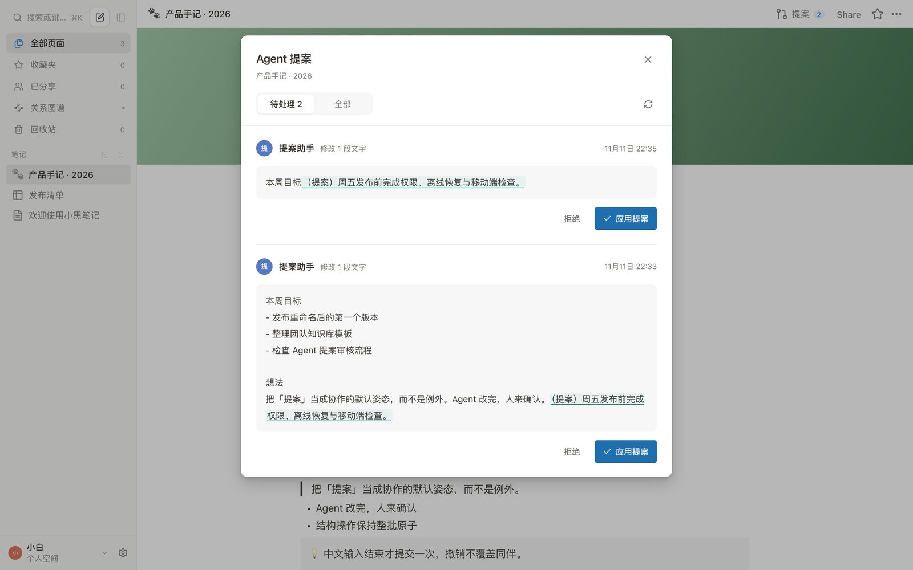
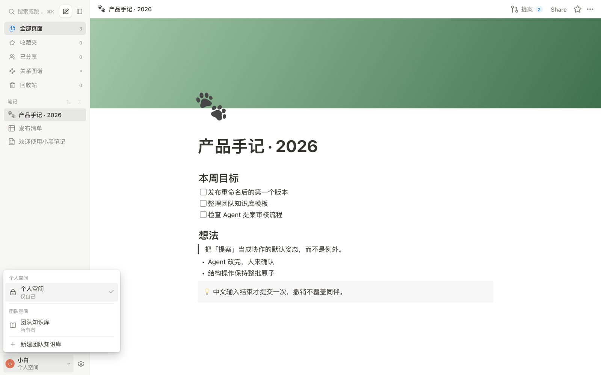

<p align="center">
  
</p>

<h1 align="center">小黑笔记 · HeiNote</h1>

<p align="center">
  数据归自己的自托管笔记本：页面、数据库、实时共编和 Agent API，都在一个 Node 进程里。
</p>

<p align="center">
  
  
  
</p>

<p align="center">
  <a href="#安装">安装</a> ·
  <a href="#配置">配置</a> ·
  <a href="#数据与备份">备份</a> ·
  <a href="#agent-接入">Agent 接入</a> ·
  <a href="#从源码构建">从源码构建</a>
</p>

<p align="center">
  
</p>

<br>

<h3 align="center">一页写完一件事</h3>

<p align="center">块编辑器写文档：标题、清单、待办、引用、提示条。<code>/</code> 打开命令菜单，页面可以配图标和封面。</p>

<p align="center">
  
</p>

<br>

<h3 align="center">数据库替笔记记结构</h3>

<p align="center">表格、看板、列表、画廊、日历视图；文本、状态、日期、人员、关联等 20 余种属性。每行本身也是一页文档。</p>

<p align="center">
  
</p>

<br>

<h3 align="center">Agent 提案，人来确认</h3>

<p align="center">Agent 令牌通过 HTTP API 读写页面与数据库；写操作默认走「提案」，在界面里逐条接受或拒绝。多人实时共编时文字自动合并，中文输入结束才提交。</p>

<p align="center">
  
</p>

<br>

<h3 align="center">个人笔记与团队知识库分区</h3>

<p align="center">个人空间只有自己可见；团队知识库按空间邀请成员，页面级权限区分所有者、编辑者和查看者。页面也可以生成公开链接分享。</p>

<p align="center">
  
</p>

<br>

## 可以做什么

- 个人 Wiki：页面树 + 块编辑器 + 全文搜索 + 关系图谱。
- 项目跟踪：数据库 + 多视图 + 负责人与状态。
- 团队知识库：成员邀请、页面权限、公共维护。
- Agent 工作流：令牌 API、页面操作、提案审核，接入任何 HTTP 客户端。

## 安装

Node.js ≥ 24：

```bash
git clone https://github.com/liu-zhengdong/heinote.git
cd heinote
npm ci
npm run build
npm start          # http://localhost:3000
```

Docker Compose：

```bash
docker compose up -d        # http://localhost:3000
```

首次打开创建的第一个账号自动成为管理员。关闭注册入口设 `REGISTRATION_OPEN=false`。

## 配置

环境变量写在 `.env`（`npm start` 自动加载）或 Compose environment 中：

| 变量 | 默认 | 说明 |
| --- | --- | --- |
| `HOST` / `PORT` | `0.0.0.0:3000` | 监听地址 |
| `DATA_DIR` | `./data` | SQLite 数据库与附件目录 |
| `PUBLIC_URL` | — | 对外访问地址，用于 GitHub 回调等 |
| `REGISTRATION_OPEN` | `true` | 是否开放注册 |
| `GITHUB_CLIENT_ID` / `GITHUB_CLIENT_SECRET` | — | GitHub OAuth 登录，可留空 |

### GitHub 登录

在 GitHub OAuth App 设置 `Authorization callback URL` 为 `PUBLIC_URL/api/auth/github/callback`，填入上面两个变量即可。「使用 GitHub 登录」按钮自动出现。

### 发布与自动部署

`.github/workflows/release.yml` 串起发版与生产更新：推送 `v*` 标签（或 Actions 里手动 Run workflow 填标签）后，流水线跑类型检查与回归，构建并把运行时产物挂到 GitHub Release，随后登录生产站调用服务自身的更新接口（与后台「关于」页一键更新同一条路径：下载产物 → 校验 → 切换 `DATA_DIR/current` → 重启 → 健康检查失败自动回滚），最后核对线上版本号。

需要在仓库配置一次：

| 位置 | 名称 | 内容 |
| --- | --- | --- |
| Actions Variable | `HEINOTE_DEPLOY_URL` | 站点地址，如 `https://heinote.shrc.babelgo.cn` |
| Actions Secret | `HEINOTE_DEPLOY_HANDLE` | 站点管理员用户名 |
| Actions Secret | `HEINOTE_DEPLOY_PASSWORD` | 对应密码 |

发版：`git tag v1.2.0 && git push origin v1.2.0`。进度看 Actions 页与服务器 `DATA_DIR/update-log/`；部署失败流水线标红，站点保留旧版本。

也可不入 CI：管理员在后台「关于」页点「检查更新」走同一条链路手动升级。

## 数据与备份

- 数据库与附件都在 `DATA_DIR` 内。整体备份复制整个目录；容器内备份执行 `node scripts/backup.mjs`，产物写入 `./backups/`。
- 页面支持单页 Markdown 导出；Admin 面板可导出全量数据。

## Agent 接入

设置页创建 Agent 令牌（read / write），然后走 REST API：

```bash
HEINOTE_URL=http://localhost:3000
HEINOTE_TOKEN=你的令牌

# 读页面
curl -H "Authorization: Bearer $HEINOTE_TOKEN" $HEINOTE_URL/api/v1/pages

# 写页面：send operations；写令牌默认生成「提案」
curl -X POST -H "Authorization: Bearer $HEINOTE_TOKEN" \
  -H "Content-Type: application/json" \
  -d '{"requestId":"demo-1","generation":"…","operations":[{"type":"insert_text","blockId":"…","index":"end","text":"Hello"}]}' \
  $HEINOTE_URL/api/v1/pages/PAGE_ID/operations
```

完整契约见 [docs/agent-api.md](docs/agent-api.md)；Node/CLI 接入示例见 [skills/heinote/SKILL.md](skills/heinote/SKILL.md)。

## 从源码构建

```bash
npm ci
npm run build      # 类型检查 + 生产构建
npm start          # 生产模式
npm run dev        # 开发模式（watch + --env-file）

npm test           # 核心回归 + HTTP 验收
npm run test:e2e   # Playwright 真实浏览器流程
```

源码布局：`server/` 服务端，`src/` 前端，`schema.ts` 共享字段声明，`tests/` 验收，`docs/` 接口与架构说明。

## 许可证

[MIT](LICENSE)
