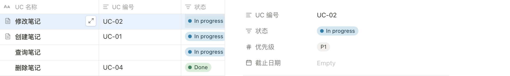

# UC-14：Agent Database HTTP 验收

日期：2026-11-10。

## 结果

Agent 可以通过 Bearer HTTP 创建真正的 Database。属性、视图和条目沿用 Notes 的现有模型。用户能在浏览器继续编辑结果。

本轮没有修改前端组件或样式。

## 自动验收

| 验证入口 | 结果 | 范围 |
| --- | --- | --- |
| `npm run build` | 通过 | 浏览器与服务器类型检查，生产资源构建 |
| `npm test` | 25 项核心、90 项 HTTP 全部通过 | 含新增 21 项独立 Database HTTP 验收 |
| `npm run test:e2e -- --grep-invert 'UC-14'` | 59 项通过 | 原有生产浏览器回归 |
| `npm run test:e2e -- tests/agent-databases-browser.test.ts` | 2 项通过 | Database 的真实浏览器端到端流程 |

HTTP 验收使用临时数据目录与真实服务。验收覆盖三条 UC 的创建和读回、六种属性、五种视图、筛选排序、分页、状态重命名迁移、类型变更、修订冲突、幂等、重启、权限交集和图片空间边界。

独立执行者用旧入口验证了基线。新数据库路径不存在。旧页面接口静默接受 Database 参数，并创建普通文档。新增验收能够识别原缺口。

## 浏览器证据

浏览器使用生产资源。Agent 使用 Bearer HTTP 创建数据库、属性、视图和条目。验证者通过界面筛选和排序，再与 HTTP 查询结果逐项比较。

Agent 在已打开的浏览器中新增条目和修改状态。界面收到更新。用户在界面修改单元格和正文后，Agent 通过 HTTP 读回一致结果。

截图包含表格和侧边条目属性。截图不含令牌。主执行者已查看原图。

## 验证边界

HTTP 查询分页使用当前数据，不保留跨请求快照。图片操作仅绑定已有同空间附件。本轮没有新增 Agent 上传接口。

本轮没有单独构建容器。部署入口和持久化格式没有变更。
